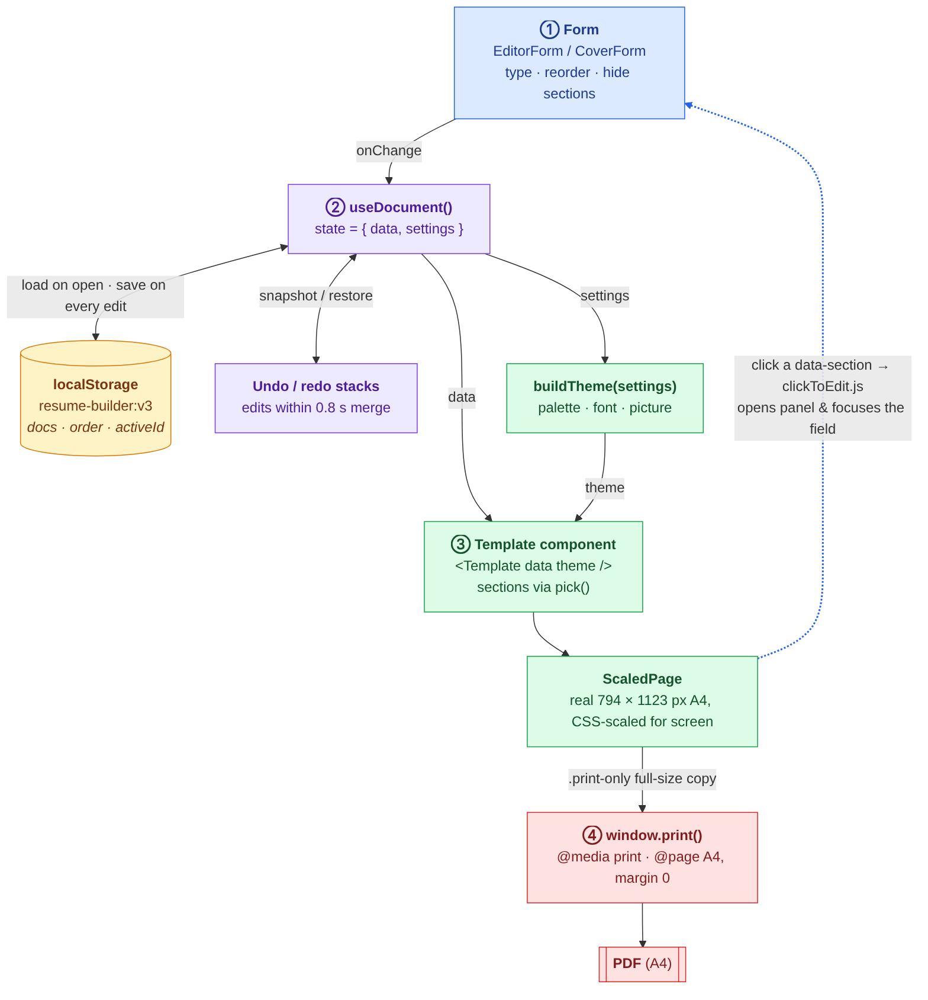

<div align="center">

# CVCraft

### Resume & cover-letter builder: 107 templates × 10 palettes, live A4 preview, click-to-edit


<p>A browser-based resume and cover-letter builder made with Next.js, React and Tailwind CSS. Your data never leaves the browser, every template is editable, and "Download PDF" works without a server.</p>

[**Features**](#a-quick-tour-of-the-features) &nbsp;•&nbsp; [**Quick Start**](#running-the-project) &nbsp;•&nbsp; [**Architecture**](#how-it-works-under-the-hood) &nbsp;•&nbsp; [**Tech Stack**](#tools-and-technologies) &nbsp;•&nbsp; [**Structure**](#project-structure-file-by-file)

</div>

---

<details>
<summary><b>Table of contents</b></summary>

- [Why we built CVCraft](#why-we-built-cvcraft)
- [Who it's for: use cases](#who-its-for-use-cases)
- [A quick tour of the features](#a-quick-tour-of-the-features)
- [Tools and technologies](#tools-and-technologies)
- [Modules and packages](#modules-and-packages)
- [How it works under the hood](#how-it-works-under-the-hood)
- [Project structure, file by file](#project-structure-file-by-file)
- [Running the project](#running-the-project)
- [Adding your own template](#adding-your-own-template)
- [Limitations and what's next](#limitations-and-whats-next)

</details>

## Why we built CVCraft

Writing a resume is hard enough without fighting a word processor. Margins shift, a second page appears out of
nowhere, and changing the design means copying everything into a new file.

CVCraft separates **what you say** from **how it looks**. You type your details once, into one form, and the
same content flows into any of **107 layouts × 10 colour themes**: more than a thousand finished designs.
Switch from a quiet ATS-friendly page to a game-character sheet with one click, and nothing you wrote is lost.

A few principles shaped the project:

- **Private by default.** No accounts, no server, no database. Everything is stored in your browser's
  `localStorage`, and photos are processed on a `<canvas>` in the page.
- **What you see is what you print.** The preview *is* the page. It is drawn at real A4 size (794 × 1123 px)
  and scaled down for the screen, so the PDF matches the preview exactly.
- **Editing should feel direct.** Click any part of the preview, a job title, an email, a bullet point, and
  the editor scrolls to that exact field with the cursor already in it.

---

## Who it's for: use cases

| Who | What they do with CVCraft |
|---|---|
| **Job seekers** | Fill in their details once, try designs until one fits the role, and download a PDF in minutes. |
| **Applicants to large companies** | Filter the gallery to **ATS-friendly** templates: single reading order, real text, no skill bars, so recruiting software can parse them. |
| **Designers and creatives** | Pick a bold layout (Poster, Swiss Brutalist, Portfolio Cover, Typography Playground) to show visual taste. |
| **Developers and engineers** | Use the Tech & AI collection: Developer Terminal, GitHub Profile, System Architecture and others. |
| **Executives** | Use the Corporate and Luxury collections: CEO Profile, Boardroom CV, Black Label and others. |
| **Students and career changers** | Use the **Suggestions** (ready-made summaries, bullets and skills for common roles) and the live **resume score** with tips. |
| **People applying to several jobs** | Keep several resumes and cover letters in **My documents**; duplicate one and tailor it per application. |
| **Anyone writing a cover letter** | Start a letter from a resume: name, contact details, colours, font and picture carry over automatically. |
| **Teachers, career coaches** | Demonstrate good resume structure live in class without asking anyone to create an account. |
| **Developers learning Next.js** | A real-world codebase showing the App Router, client state, undo/redo, printing, canvas image processing and a plug-in template system. |

---

## A quick tour of the features

**The editor (`/editor`)**
- Live A4 preview beside the form; on phones, Edit and Preview become two tabs.
- **Click-to-edit:** click anything on the preview to jump to its exact field. The bullet you clicked is even
  selected in its text box.
- **Undo / redo** for every change (Ctrl/⌘+Z, Ctrl/⌘+Shift+Z); rapid typing in one field counts as one step.
- **Sections & order:** drag sections to reorder them and hide the ones you don't need.
- **Resume score** out of 100 with practical tips: action verbs, numbers in bullets, length, placeholders left.
- **Suggestions:** ready-made summaries, bullet points and skills for common roles.
- **Colours, fonts, picture:** 10 palettes, 16 selectable fonts, and a picture setting (your photo, initials,
  or a simple woman, man or neutral avatar). Sketch templates also offer six hand-drawn girls.
- **Page-break markers** show where a second page would start.
- **Download PDF** uses the browser's print dialog ("Save as PDF").

**The gallery (`/templates`)**
- Every layout in every palette, with live thumbnails that load as you scroll.
- Filters for collection, tier, style, columns, photo / no photo, ATS-friendly, character and colour, plus search.

**My documents (`/documents`)**
- All saved resumes and cover letters, with open, rename, duplicate, delete and "+ Letter" (a matching cover letter).

**The template library**
- **32 originals**, including 12 premium designs and 5 sketch-style designs with hand-drawn illustrations.
- **75 designs from the "80 premium CV concepts" collection**, in 10 categories: Minimal, Luxury, Corporate,
  Creative, Tech & AI, Editorial, Infographic, Futuristic, Fun & personality, and Special formats.
- **6 cover-letter designs** that match the resume palettes and fonts.

---

## Tools and technologies

| Technology | Version | What it does here |
|---|---|---|
| **Next.js** (App Router) | 14.2.15 | Routing (`/`, `/templates`, `/editor`, `/documents`), page metadata, font loading, dev server and production build. |
| **React** | 18.3.1 | All UI and every resume template is a React component; hooks manage editor state. |
| **JavaScript (ES2022, JSX)** | — | The whole codebase; no TypeScript. `jsconfig.json` adds the `@/` import alias. |
| **Tailwind CSS** | 3.4.14 | Styling of the app shell: editor, gallery, forms, buttons. |
| **Inline styles** | — | Templates use inline `style` objects so they print exactly and can't clash with app CSS. |
| **PostCSS + Autoprefixer** | 8.4.47 / 10.4.20 | Runs Tailwind and adds vendor prefixes to the CSS. |
| **next/font (Google Fonts)** | built into Next | Downloads 20 font families at build time and serves them locally, so no requests go to Google at runtime. |
| **SVG** | — | Icons, charts, avatars, sketch illustrations, decorations, all drawn inline. |
| **Browser APIs** | — | `localStorage` (saving), Canvas 2D (photo resize), `IntersectionObserver` (lazy thumbnails), `ResizeObserver` (preview scaling), `window.print()` + CSS `@media print` / `@page` (PDF). |
| **Node.js / npm** | Node ≥ 18.17 (tested on 20.20), npm 10 | Install dependencies and run the dev server. |

Fonts loaded through `next/font`: Lato, Inter, Poppins, Montserrat, Raleway, Merriweather, Playfair Display,
Oswald, Caveat, Cinzel, Cormorant Garamond, Space Grotesk, IBM Plex Mono, Manrope, Libre Baskerville, Sora,
Nunito, Bebas Neue, Rye and Press Start 2P.

---

## Modules and packages

<details>
<summary><b>Show the full modules and packages</b></summary>

CVCraft deliberately has a **tiny dependency list**. Everything else (charts, avatars, PDF, storage, undo) is
written in the project itself.

### npm dependencies (`package.json`)

| Package | Type | Version | Why it's needed |
|---|---|---|---|
| `next` | dependency | 14.2.15 | The framework: router, dev server, build, `next/link`, `next/navigation`, `next/font/google`. |
| `react` | dependency | 18.3.1 | UI library. |
| `react-dom` | dependency | 18.3.1 | Renders React in the browser. |
| `tailwindcss` | devDependency | 3.4.14 | Utility-first CSS for the app interface. |
| `postcss` | devDependency | 8.4.47 | CSS processor that Tailwind runs on. |
| `autoprefixer` | devDependency | 10.4.20 | Adds browser prefixes to the generated CSS. |

### npm scripts

| Script | Command | Purpose |
|---|---|---|
| `npm run dev` | `next dev` | Development server with hot reload. |
| `npm run build` | `next build` | Optimised production build into `.next/`. |
| `npm start` | `next start` | Serves the production build. |

### The project's own modules (the important ones)

| Module | Role |
|---|---|
| `lib/useDocument.js` | The editor's brain: loads and saves the open document and provides undo/redo and every update function. |
| `lib/documents.js` | Storage layer: reads and writes all documents in `localStorage`, migrates old data, creates resumes and letters. |
| `components/templates/index.js` | Template registry: every layout, the gallery catalogue and `buildTheme()`. |
| `components/templates/kit.js` | Section toolkit used by all templates: section ordering (`pick`), section bodies, ratings, contact lists. |
| `components/templates/shared.js` | Low-level template parts: A4 page style, `Photo`, bullets, timelines, colour mixing. |
| `lib/clickToEdit.js` | Maps a click on the preview to the matching form field by matching text against the resume data. |
| `lib/resumeScore.js` | The 100-point resume score and tips. |

</details>

---

## How it works under the hood

<p align="center">
  
</p>

1. **One data model, many layouts.** A resume is a plain object: `personal`, `experience`, `education`,
   `projects`, `skills`, `languages`, `certifications`, `interests`, plus `sectionOrder` and `hiddenSections`.
   Every template receives that same object and a `theme` (palette colours, font, picture choice).
2. **Templates are pure components.** A template is `function Name({ data, theme })` that returns one A4 page.
   It renders sections through `pick()`, so it automatically follows the user's order and skips hidden or
   empty sections.
3. **Saving** happens after every change: `useDocument` writes the document back into `localStorage`.
4. **Undo/redo** keep snapshots of `{ data, settings }`. Edits to the same field within 0.8 s merge into one step.
5. **Preview scaling.** `ScaledPage` draws the page at full size and shrinks it with a CSS transform, so the
   preview and the print are the same layout.
6. **Printing.** The page holds two copies of the resume: the scaled preview (`.screen-only`) and a full-size
   copy (`.print-only`). Print CSS hides everything except the full-size copy and sets `@page { size: A4; margin: 0 }`.
7. **Click-to-edit.** Each template marks its sections with `data-section="experience"` and so on. On a click, the
   editor reads the clicked text, finds the matching field in the data (`lib/clickToEdit.js`), opens its panel,
   scrolls to it and focuses it.
8. **Performance.** Gallery and editor thumbnails render only when scrolled into view (`LazyThumb`). The editor's
   template strip refreshes half a second after typing stops (`LayoutStrip`).

---

## Project structure, file by file

<details>
<summary><b>Show the full project structure, file by file</b></summary>

```
Resume builder/
├── public/                 static files served as-is
├── src/
│   ├── app/                Next.js App Router: pages, layouts, global CSS
│   ├── components/         React components: app UI and all resume templates
│   └── lib/                data, storage, scoring and helper logic (no UI)
├── package.json            ...
└── run.sh                  one-command launcher
```

### Root

| Path | One-line explanation |
|---|---|
| `README.md` | This guide. |
| `run.sh` | Helper script: installs dependencies and runs the dev server, build or production server. |
| `package.json` | Project name, npm scripts and the dependency list. |
| `package-lock.json` | Exact installed versions of every package, for reproducible installs. |
| `next.config.mjs` | Next.js configuration (defaults). |
| `jsconfig.json` | Adds the `@/` → `src/` import alias. |
| `tailwind.config.js` | Tells Tailwind which files to scan for class names. |
| `postcss.config.mjs` | Enables Tailwind and Autoprefixer in the CSS pipeline. |
| `.gitignore` | Keeps `node_modules`, `.next`, logs and local env files out of version control. |
| `node_modules/` | Installed packages (created by `npm install`; never edit). |
| `.next/` | Build and dev-server output (generated; safe to delete when the server is stopped). |
| `Screenshot *.png` | Design reference screenshots; not used by the app. |

### `public/`

| Path | One-line explanation |
|---|---|
| `public/templates/sketch-girl.png` | Transparent cut-out of the ink-sketch girl used by the Sketchbook template. |
| `public/templates/sketchbook-reader.jpg` | The original full sketch (no longer used by the template; kept as a source image). |

### `src/app/`: pages and routing

| Path | One-line explanation |
|---|---|
| `app/layout.js` | Root HTML layout: loads all 20 fonts as CSS variables and sets the site title. |
| `app/globals.css` | Tailwind import, click-to-edit hover/highlight styles and the print rules that produce the PDF. |
| `app/icon.svg` | Browser-tab icon. |
| `app/not-found.js` | The 404 page. |
| `app/page.js` | Landing page: hero with live template previews, feature list and calls to action. |
| `app/templates/layout.js` | Page title and description for the gallery. |
| `app/templates/page.js` | Template gallery with search and filters (collection, tier, style, columns, photo, ATS, colour). |
| `app/editor/layout.js` | Page title and description for the editor. |
| `app/editor/page.js` | The editor: form, live preview, template strip, colours, fonts, picture, undo/redo, click-to-edit, PDF. |
| `app/documents/layout.js` | Page title and description for My documents. |
| `app/documents/page.js` | Lists saved resumes and letters with open, rename, duplicate, delete and "+ Letter". |

### `src/lib/`: logic and data

| Path | One-line explanation |
|---|---|
| `lib/documents.js` | `localStorage` storage for all documents, migration of older saves, and creation of new resumes and letters. |
| `lib/useDocument.js` | React hook that opens a document, saves every change and provides undo/redo and update functions. |
| `lib/sampleResume.js` | The resume data shape, default section order and the example resume. |
| `lib/sampleCover.js` | The cover-letter data shape and the example letter. |
| `lib/palettes.js` | The 10 colour palettes, the font list and `fontStack()` for CSS font families. |
| `lib/resumeScore.js` | Scores a resume out of 100 with weighted checks and practical tips. |
| `lib/writingHelp.js` | Ready-made summaries, bullets, skills and letter paragraphs for common roles; action verbs and weak phrases. |
| `lib/clickToEdit.js` | Finds which form field a click on the preview refers to by matching the clicked text with the data. |
| `lib/avatarTools.js` | *(Legacy, unused)* canvas cartoon filters and colour detection from an earlier avatar feature. |
| `lib/avatarPresets.js` | *(Legacy, unused)* preset looks for the old avatar designer. |

### `src/components/`: app interface

| Path | One-line explanation |
|---|---|
| `components/SiteHeader.js` | Top navigation bar (logo, Templates, My documents, Editor) with a slot for page actions. |
| `components/SiteFooter.js` | Site footer. |
| `components/LazyThumb.js` | Renders a template thumbnail only when it scrolls near the screen, then keeps it. |
| `components/landing/TemplateShowcase.js` | Overlapping live template previews for the landing page hero and template rows. |
| `components/editor/EditorForm.js` | Resume form: personal details, photo, picture choice and list panels for every section. |
| `components/editor/CoverForm.js` | Cover-letter form: link to a resume, your details, recipient and letter body. |
| `components/editor/SectionOrder.js` | Drag-and-drop (or arrows) section ordering with show/hide toggles. |
| `components/editor/Suggestions.js` | The "✨ Suggestions" picker for summaries, bullets, skills and letter paragraphs. |
| `components/editor/ScorePanel.js` | Live resume score ring and tips list. |
| `components/editor/ScaledPage.js` | Scales a full-size A4 page to fit its container and marks page breaks. |
| `components/editor/LayoutStrip.js` | The editor's lazy, debounced strip of template thumbnails. |
| `components/editor/AvatarPanel.js` | *(Legacy, unused)* the old avatar designer and cartoon-filter panel. |

### `src/components/templates/`: the template engine

| Path | One-line explanation |
|---|---|
| `templates/index.js` | Registry of all 107 layouts, the gallery catalogue (layouts × palettes) and `buildTheme()`. |
| `templates/kit.js` | Section toolkit: `pick()` ordering, `SectionBody`, ratings (bars, dots, rings, tags…), `ContactList`, `levelWord()`. |
| `templates/shared.js` | Page size and style, `Photo`, `BulletList`, `TimelineItem`, `contactItems`, `mix()` and legacy character drawings. |
| `templates/Icon.js` | Small stroke icon set used inside templates. |
| `templates/simpleAvatar.js` | The three flat avatars (woman, man, neutral) and picture-setting normalisation. |
| `templates/portrait.js` | *(Legacy)* detailed vector portrait used only to display avatars saved by older versions. |
| `templates/sketchGirls.js` | Six hand-drawn ink girls (bun, bob, hijab, braids, pixie, ponytail) for sketch templates. |
| `templates/sketchKit.js` | Shared sketch parts: handwriting font, pen underlines, doodles, washi tape, sketch portrait. |
| `templates/letters/index.js` | The six cover-letter designs and `buildLetterTheme()`. |
| `templates/layouts/SidebarTimeline.js` | Shared layout used by Horizon and Azure: sidebar with photo plus timelines. |

**Original layouts (`templates/*.js`)**

| File | One-line explanation |
|---|---|
| `Horizon.js` | Grey sidebar under a colour block, diagonal corner shapes and rounded skill bars. |
| `Azure.js` | Gradient bands, a dark diagonal stripe and a ringed photo. |
| `Sandstone.js` | Soft curves, outlined pill headings, language bars and interest icons. |
| `Midnight.js` | Dark sidebar, a coloured name banner and skill percentage bars. |
| `Classic.js` | Centred serif header and ruled headings; ATS-friendly. |
| `Executive.js` | Single column with a top colour band and bar-marked headings; ATS-friendly. |
| `Minimal.js` | Section labels in a narrow left column, lots of white space; ATS-friendly. |
| `Compact.js` | Dense two-column page that fits a lot; ATS-friendly. |
| `TimelinePro.js` | Date column with a vertical rule beside every entry; ATS-friendly. |
| `Banner.js` | Full-width coloured header with photo and a tinted side panel. |
| `Split.js` | Main column plus a full-height coloured sidebar with photo. |
| `Wave.js` | Coloured header and footer with double waves. |
| `Geometric.js` | Rotated diamond shapes, rounded-square photo and dot ratings. |
| `Bold.js` | Oversized two-tone name, rounded photo and a contact strip. |
| `Elegant.js` | Centred photo, serif name, double rule and hairline-split columns. |

**Premium layouts (`templates/premium/`)**

| File | One-line explanation |
|---|---|
| `Aurora.js` | Glowing gradient header and a floating content card. |
| `Prestige.js` | Rich colour panel, fine frame lines, serif name and ornaments. |
| `Infographic.js` | Icon-node timeline, skill segments and language rings. |
| `Mosaic.js` | Tiled header and every section in its own rounded card. |
| `Ribbon.js` | Folded ribbon headings and a dotted sidebar. |
| `Studio.js` | Editorial layout with a vertical name strip and numbered sections. |
| `Arch.js` | Tall arched sidebar with the portrait at the top. |
| `Milestone.js` | Gantt-style career timeline and colour-tagged cards. |
| `Storybook.js` | Dreamy dark page inside a hand-drawn thought bubble. |
| `Gazette.js` | Vintage poster typography and three ruled columns. |
| `Scrapbook.js` | Polaroid photo, tape and sticky notes on dotted paper. |
| `Daydream.js` | Pastel thought clouds around the portrait. |
| `Sketchbook.js` | Aged sketchbook page with the ink-sketch girl, handwritten notes and a coffee ring. |

**Sketch layouts (`templates/sketch/`)**

| File | One-line explanation |
|---|---|
| `Notebook.js` | Lined school-notebook page with spiral holes and highlighter headings. |
| `PolaroidTape.js` | Taped polaroid, sticky notes and washi-tape headings on a pinboard grid. |
| `JournalSpread.js` | Open two-page journal with a spine shadow and ribbon bookmark. |
| `MarginDoodles.js` | White page with a doodled margin: stars, arrows, ticked skills. |

### `src/components/templates/collection/`: the 80-concept collection

| Path | One-line explanation |
|---|---|
| `collection/index.js` | Merges the ten category registries and lists the category names for the gallery filter. |
| `collection/<category>.js` | Registry for one category: each entry's id, name, component, styles, ATS flag and description. |

**Minimal & modern (`collection/minimal/`)**

| File | One-line explanation |
|---|---|
| `SwissMinimal.js` | Strict grid, huge two-line name, numbered sections between thin rules; ATS. |
| `QuietLuxury.js` | Ivory page, Cormorant name, understated italic headings; ATS. |
| `ModernEssential.js` | Prominent full-width name with a compact left sidebar. |
| `InvisibleGrid.js` | Every line snaps to three unseen columns with faint hairlines; ATS. |
| `MonochromePro.js` | Black-and-white columns with a solid black rail and heavy/hairline name. |
| `AiryResume.js` | Wide margins and generous spacing; ATS. |
| `GeometricMinimal.js` | A different geometric marker per section and circle-dot ratings. |
| `TypographyFirst.js` | Oversized serif name and expressive italic headings; ATS. |

**Premium & luxury (`collection/luxury/`)**

| File | One-line explanation |
|---|---|
| `BlackLabel.js` | Matte-black page with palette-driven gold type and a framed portrait. |
| `ExecutiveSignature.js` | Signature-style italic name on a fine rule; ATS. |
| `PlatinumProfile.js` | Brushed-silver header, metallic seal and credential cards. |
| `BurgundyElite.js` | Cream editorial page with a masthead and drop-cap profile. |
| `RoyalPortfolio.js` | Emerald band, arched portrait and a corner-bracketed profile. |
| `MaisonResume.js` | Magazine-cover name, pull-quote profile and numbered sections. |
| `HeritageProfessional.js` | Ivory Baskerville page with a monogram crest; ATS. |

**Corporate & executive (`collection/corporate/`)**

| File | One-line explanation |
|---|---|
| `CeoProfile.js` | Executive summary and a band of leadership achievements; ATS. |
| `CorporateStandard.js` | Full-width header and a labelled contact sidebar; ATS. |
| `ConsultingEdge.js` | Hanging-label grid with outcome-first bullets; ATS. |
| `LeadershipLadder.js` | Career drawn as an ascending staircase of roles. |
| `BoardroomCv.js` | Masthead with executive biography and board appointments; ATS. |
| `FinanceProfessional.js` | Ledger-style bullets with key figures in a number column; ATS. |
| `LegalProfessional.js` | Traditional serif CV with practice areas and admissions; ATS. |
| `GlobalExecutive.js` | Globe sidebar, languages and a "footprint" of locations. |

**Creative & design (`collection/creative/`)**

| File | One-line explanation |
|---|---|
| `CreativeStudio.js` | Colourful identity block and portfolio highlight cards. |
| `PosterResume.js` | Gig-poster layout with a huge Bebas name and ticker strip. |
| `SwissBrutalist.js` | Rigid ruled grid with oversized section numerals. |
| `ArtDirector.js` | Magazine spread with an editorial portrait and creative-direction box. |
| `ColorBlock.js` | Full-bleed colour panels with geometric section marks. |
| `TypographyPlayground.js` | Every heading in its own typeface; type-specimen style. |
| `PortfolioCover.js` | Personal-brand cover column and abstract project tiles. |

**Tech & AI (`collection/tech/`)**

| File | One-line explanation |
|---|---|
| `DeveloperTerminal.js` | Dark terminal window, every section opened by a shell command. |
| `GitHubProfile.js` | Developer-profile page with pinned project cards and a contribution heatmap. |
| `AIEngineer.js` | Neural-net header motif and highlighted metrics; ATS. |
| `SystemArchitecture.js` | Blueprint grid with skills drawn as a service diagram. |
| `CyberGrid.js` | Neon grid, HUD brackets and a hexagon portrait. |
| `ProductEngineer.js` | Label rail and outcome-first bullets; ATS. |
| `CloudArchitect.js` | Case-study cards and hexagon certification badges. |
| `DataScientist.js` | Key-results strip pulled from bullets; ATS. |

**Editorial & magazine (`collection/editorial/`)**

| File | One-line explanation |
|---|---|
| `VogueResume.js` | Fashion-magazine page with a centred oversized name. |
| `AnnualReport.js` | Report cover band, performance highlights and tenure chart. |
| `ModernJournal.js` | Literary-journal page with prose entries and ornament dividers. |
| `CoverStory.js` | Magazine cover with masthead, cover lines, photo and barcode. |
| `SwissPublication.js` | Six-column typographic grid with large thin numerals. |
| `EditorialTimeline.js` | Career written as a feature article with datelines and pull quotes. |
| `AcademicJournal.js` | Journal-article first page: abstract, citations and Table 1 skills. |

**Infographic & visual (`collection/infographic/`)**

| File | One-line explanation |
|---|---|
| `metrics.js` | Helpers that pull headline numbers out of bullets and compute year spans. |
| `SkillMatrix.js` | Graph-paper skills × level matrix. |
| `AchievementDashboard.js` | KPI tiles, tenure chart and language gauges. |
| `JourneyMap.js` | Career stops on a winding road in date order. |
| `CircularProfile.js` | Circle-framed photo with ring charts. |
| `DataStory.js` | Gantt chart, outcome charts and a skills column chart. |
| `ModularCards.js` | Outlined content cards with module codes. |
| `ProgressionCv.js` | Roles as levels on a progress track with promotion steps. |

**Futuristic & experimental (`collection/futuristic/`)**

| File | One-line explanation |
|---|---|
| `BrutalistArchitecture.js` | Concrete page, heavy-bordered slabs and an architect's title block. |
| `NeoFuturist.js` | Electric highlights and technical metadata on a measured rail. |
| `GlassmorphismCv.js` | Frosted panels over soft gradient blobs. |
| `BlueprintProfessional.js` | Blueprint sheet with callouts and dimension lines. |
| `HolographicIdentity.js` | Holographic ID card and iridescent accents. |
| `SpatialResume.js` | Floating 3D-shaded shapes and an oversized staggered name. |
| `InterfaceCv.js` | App-dashboard layout with sidebar menu and KPI tiles. |

**Fun & personality (`collection/playful/`)**

| File | One-line explanation |
|---|---|
| `MemeProfessional.js` | Clean CV with joke section labels. |
| `ProductPackagingCv.js` | You as a boxed product with a "Skill Facts" label. |
| `ClassifiedAd.js` | Newspaper classifieds with a marker-circled ad and tear-off tabs. |
| `MissionControlCv.js` | Space console with GO lights and a mission log. |
| `SuperheroProfile.js` | Comic panels, halftone dots and power meters. |
| `BingeWorthyCv.js` | Streaming-show page with jobs as episodes. |
| `GameCharacterCv.js` | RPG character sheet with stats, quests and inventory. |
| `WantedPoster.js` | Old-West wanted poster with a tongue-in-cheek reward. |

**Special formats (`collection/special/`)**

| File | One-line explanation |
|---|---|
| `ThreeColumnCv.js` | Contact & skills / experience / projects & education columns. |
| `HorizontalResume.js` | Left-to-right bands with a horizontal career timeline. |
| `SplitScreenCv.js` | True 50/50 split: identity panel with photo, details beside it. |
| `AsymmetricMagazineCv.js` | Narrow sidebar against a wide column with huge italic headings. |
| `TimelineSplitCv.js` | Central timeline with work on one side, studies on the other. |
| `InfographicPosterCv.js` | Dark one-page poster with "by the numbers" stats and charts. |
| `AccordionCv.js` | Every section as an expanded accordion panel. |
| `FoldedBrochureCv.js` | Tri-fold leaflet with dashed fold lines. |

</details>

---

## Running the project

### Requirements
- **Node.js 18.17 or newer** (tested on Node 20.20) and npm.
- macOS, Linux, or Windows with Git Bash / WSL for `run.sh`.
- An internet connection the first time, so `next/font` can download the Google Fonts.

### The quick way: `run.sh`

```bash
chmod +x run.sh        # once
./run.sh               # install if needed, then start the dev server on http://localhost:3000
./run.sh dev --lan     # also reachable from other devices on your network
PORT=3010 ./run.sh     # pick another port
./run.sh build         # production build (refuses while a dev server is using .next)
./run.sh start         # serve the production build
./run.sh clean         # delete .next build output
./run.sh help          # all options
```

### The manual way

```bash
npm install
npm run dev            # http://localhost:3000
# production:
npm run build && npm start
```

Then open:
- `/`: landing page
- `/templates`: the gallery
- `/editor`: the editor (opens your last document, or the example resume)
- `/documents`: your saved documents

> **Tip:** to save a PDF, click **Download PDF** in the editor and choose "Save as PDF". For dark templates,
> make sure "Background graphics" is ticked in the print dialog.

> **Don't run `next build` while `next dev` is running** in the same folder. They share the `.next` directory and
> the dev server will start failing. `run.sh build` checks for this and stops.

---

## Adding your own template

1. Create `src/components/templates/collection/<category>/MyDesign.js`:

   ```jsx
   import { pageStyle, contactItems } from "../../shared";
   import { SECTION_META, SectionBody, fontOf, pick } from "../../kit";

   // My Design: one-line description of the look.
   export default function MyDesign({ data, theme }) {
     const p = data.personal;
     const o = { primary: theme.primary, text: "#222", muted: "#666", fs: 11.5 };
     return (
       <div className="resume-page" style={pageStyle({ fontFamily: fontOf(theme, "inter"), padding: 48 })}>
         <h1 style={{ color: theme.primary }}>{p.name}</h1>
         <div data-section="contact">{contactItems(p).map((c) => <span key={c.icon}>{c.value} </span>)}</div>
         {pick(data, ["summary", "experience", "education", "skills"]).map((k) => (
           <section key={k} data-section={k}>
             <h3>{SECTION_META[k].title}</h3>
             <SectionBody k={k} data={data} o={o} />
           </section>
         ))}
       </div>
     );
   }
   ```

2. Register it in `src/components/templates/collection/<category>.js`:

   ```js
   { id: "my-design", name: "My Design", component: MyDesign, collection: "<category>",
     styles: ["Modern"], columns: 1, photo: false, ats: true, premium: false,
     defaultFont: "inter", description: "One line for the gallery." }
   ```

3. Rules that keep the library consistent:
   - The page must fit 794 × 1123 px with the example resume.
   - Render sections through `pick()` and tag them with `data-section` so ordering, hiding and click-to-edit work.
   - Take colours from `theme.primary`, `theme.accent` and `theme.light` so every palette works.
   - Use inline styles only, and no external images or fonts.
   - Only mark `ats: true` for single-reading-order designs with real text and no rating graphics.

---

## Limitations and what's next

- **Data lives in one browser.** Clearing site data deletes your documents, and a document doesn't follow you to
  another device. Large photos count toward the browser's ~5 MB `localStorage` limit; when it is full, saving fails
  silently today. An export/import button and IndexedDB for images are the natural next steps.
- **PDF comes from the print dialog.** Results depend slightly on the browser; Chrome gives the most faithful output.
- **Some numbers are guessed.** Templates that pull figures out of bullet text (Finance, Data Story, dashboards)
  use pattern matching, so unusual wording can pick a less useful number.
- **Legacy files.** `AvatarPanel.js`, `avatarTools.js` and `avatarPresets.js` belong to a removed avatar designer
  and can be deleted. `portrait.js` and the character drawings in `shared.js` remain only to display avatars saved by
  older versions.
- **No automated tests yet.** The score, storage migration and undo/redo logic are pure functions and good first
  candidates.

---

*Built with Next.js, React, Tailwind CSS and a lot of SVG. Fill it in once, and wear any design.*

---

<div align="center">

**Built by [Mian Basam Ahmad](https://github.com/Mian-Basam)** · Software Engineer & Tech Lead

[](https://mian-basam.github.io) [](https://www.linkedin.com/in/mian-basam-ahmad-68b997147/) [](https://github.com/Mian-Basam)

<sub>If this project helped you, consider giving it a ⭐</sub>

</div>
